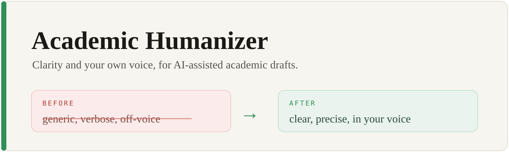

<div align="center">



[](LICENSE)
&nbsp;
&nbsp;
&nbsp;

</div>

## 为什么开发这个技能

我们团队成员经常撰写论文和基金申请，并开始使用 AI 协助起草。问题是，AI 辅助生成的草稿往往空泛、冗长，常以 “In recent years...” 开场，堆砌夸大的措辞和过长的句子。它们还会偏离作者自己的声音，丢失学术写作所依赖的精确性。

市面上有一些名为 “humanizer” 的工具，但它们是为博客和营销文案设计的。把这类工具用于论文或 NSF 申请，会把精确性连同其他东西一起抹平。学术写作赖以成立的审慎措辞，恰恰最先被删掉。

因此我们编写了这个技能。为了校准效果，我们让 AI 将自己的草稿与团队已录用论文和已获批基金申请进行比较，再逐项人工梳理差异。这个项目并不复杂，也不是为了钻评审空子、规避检测器或添加虚假的新颖性。我们希望 AI 辅助草稿能够表达清楚，保持作者自己的声音，同时让数字、引文和主张保持原样。

## 伦理与披露

这是一个用于提升清晰度和声音一致性的编辑辅助工具，并以作者过去已录用的作品为参照。它不会生成研究发现、编造数据或更改引文，也不是为了规避 AI 使用检测。使用本技能不会消除披露 AI 协助的义务：始终遵守投稿目标机构或项目的披露政策。

## 效果示例

> [!CAUTION]
> **修改前**（一段通用的 AI 草稿）：
>
> In recent years, continual learning has attracted increasing attention and achieved remarkable
> success. However, existing methods still face crucial challenges. In this proposal, we propose a novel
> framework that leverages cutting-edge techniques to delve into these intricate problems, paving the way
> for a transformative paradigm that will revolutionize the field.

> [!TIP]
> **修改后**（表述清楚、贴合作者声音，并让主张对应证据）：
>
> Continual learning matters, but today's methods stay empirical and their principles are unclear. That
> limits reliability and progress. This proposal builds a principled framework on three fronts:
> adaptation, soft supervision, and cross-domain knowledge. We demonstrate it on autonomous driving and
> network management.

更多前后对照见 [`examples/before-after.md`](examples/before-after.md)：其中一个是一般示例，另一个是 NIH Specific Aims 页面示例，还有一个是已获资助的 NSF CAREER 摘要示例。为保留英文论文示例的原始语境，示例正文继续使用英文。

---

## 功能

- **锐化清晰度与作者声音**：删减通用的 AI 措辞（“paves the way”、“extensive experiments”、“to the best of our knowledge”、“In recent years...”、delve/underscore/tapestry、强行三段式、超长句和长破折号），让草稿更接近作者自己的风格。
- **让主张对应证据**：不让动词强于数据（`prove` → `show empirically`），并把含糊的幅度改成带有归属说明的数值区间。
- **保留真正的学术表达**：保留有证据支撑的限定语、合适的被动语态、`we`、定义、符号和每一处引文。不会改动数字或参考文献。
- **提供独立的基金申请模式（NSF、NIH）**：保留论文模式通常会删去的愿景表达，并把大部分编辑精力放在前几页，因为评审正是在那里形成评分。

## 安装

```bash
git clone https://github.com/AIScientists-Dev/academic-humanizer ~/.claude/skills/academic-humanizer
```

它只是普通的 `SKILL.md` 加示例，因此也可作为 **Codex** 和 **MorphMind** 的技能或系统提示词运行。让智能体读取 `SKILL.md` 即可。

## 使用

```
/academic-humanizer
[paste a section, or point at main.tex]
# optionally: "match my voice from prior_paper.pdf; target venue: ICLR"
```

## 根据自己情况调整

这里的规则反映的是一个团队的声音。可以 fork 仓库并按自己的风格调整：让它读取你过去的几篇论文，保留适合你所在领域的检查项，再调整其余部分。这个技能本来就应个性化使用，而不是一刀切的过滤器。

## 工作方式

共六层：通用 AI 痕迹目录 → 学术领域特有的 AI 痕迹 → 保留学术规范 → 主张与证据匹配 → 声音与期刊风格校准 → 基金申请模式（NSF/NIH 结构、前几页优先、主张与可行性匹配）。审计 → 改写的循环定义见 [`SKILL.md`](SKILL.md)。

## 参考资料

第 6 层提炼了 NSF 和 NIH 申请中相对稳定的结构。若需了解当前具有约束力的要求（页数、格式、截止日期等），请查阅官方来源：

- NSF：[Proposal & Award Policies & Procedures Guide (PAPPG)](https://www.nsf.gov/policies/pappg)
- NSF：[CAREER program](https://new.nsf.gov/funding/opportunities/career-faculty-early-career-development-program)
- NIH：[Write Your Application](https://grants.nih.gov/grants/how-to-apply-application-guide/format-and-write/write-your-application.htm)（Specific Aims、Significance、Innovation、Approach）

## 致谢

- **[blader/humanizer](https://github.com/blader/humanizer)**（MIT）。**重点：** 删除博客、随意文本和百科式文本中的通用 AI 写作模式。本技能复用了它第 1 层的通用 AI 痕迹目录，并将其扩展到学术写作。
- **[koaeraser/ARMS](https://github.com/koaeraser/ARMS)**。**重点：** 面向统计/方法学研究论文的自动流水线（从想法到经过验证和修订的稿件）。这是一个互补且范围更广的项目，也为本项目强调主张与证据、数值精确性提供了启发。

本技能是更窄的一块：一次只做编辑的**单用途处理**，提升清晰度、让主张对应证据，同时保留作者的学术声音。

## 许可证

MIT。
