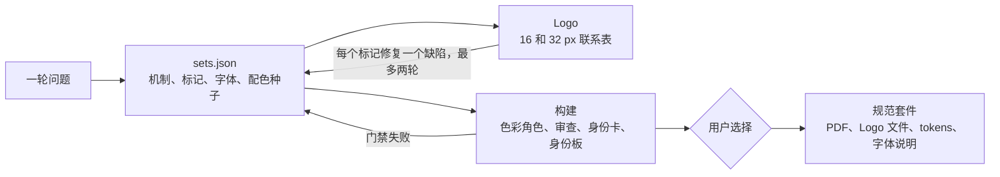

<div align="center">

<picture>
  <source media="(prefers-color-scheme: dark)" srcset="https://raw.githubusercontent.com/fatihaydost/brand-identity-skill/532742d7477dba3b744433adf92845642953dc28/docs/images/logo-dark.png">
  
</picture>

# brand-identity

[](https://github.com/fatihaydost/brand-identity-skill/actions/workflows/test.yml)
[](https://github.com/fatihaydost/brand-identity-skill/releases/latest)
[](LICENSE)

</div>

[English README](README.md) | 简体中文

这是一个面向 Claude Code 及兼容 Agent Skills 工具的品牌识别技能：把 **Logo、字体和色彩作为一个系统，从同一个视觉概念出发共同设计**，通过测量进行验证，用身份卡并排展示，并为你选定的方案交付品牌规范套件。


<sub>二十四份不同的品牌 brief，每份展示一个方向：里昂的灯光节、墨西哥城的小餐馆、雅典的药店、柏林的技术音乐厂牌、奥斯陆的漂浮桑拿、儿童牙科诊所、除草机器人创业公司、黑海蜂蜜合作社等。图中包含吉祥物、徽章、字母组合、模板字和普通文字标识；所有标记、字体和颜色都来自运行此技能得到的结果。</sub>


**[交付内容](#交付内容)** · **[示例](#示例)** · **[安装](#安装)** · **[使用](#使用)** ·
**[工作原理](#工作原理)** · **[网络与隐私](#网络与隐私)** · **[开发](#开发)**

## 交付内容

- **三套（最多四套）品牌识别方案**。每套围绕一个统一的视觉机制展开，由同一个机制同时生成标记、字体选择和色彩，使三者相互关联，而不是分别拼凑。
- **用测量代替断言。** 检查 WCAG 2.2 对比度、色盲模拟、品牌语言所需的字形覆盖、字体许可、等宽数字，以及 Logo 在 16 px 和 32 px 下的渲染。测量失败会被视为方案必须修复的门禁；启发式结果标记为警告；审美判断会明确标记为判断。
- **减少“典型 AI 品牌感”。** 技能知道普通模型常用的安全选择，并要求每次使用这些默认项时都能从 brief 中得到理由（详见[后文](#为什么方案不像典型-ai-品牌)）。每轮至少有一套方案不使用任何默认项。
- **为选定方案生成品牌规范套件**：8 页 PDF，包括封面、理念、Logo、变体、针对“这个 Logo”绘制的背景与错误使用示例、色彩、字体和应用；使用 `--full` 可扩展到 13 页，加入网格、深色模式、无障碍、图标与影像。另附 Logo 文件（SVG 和 PNG：全彩、单色、反白、应用图标、favicon）、设计 tokens（CSS、SCSS、Tailwind、DTCG JSON）和含嵌入代码的字体说明。
- **重设计现有网站。** 提供 URL 后，技能会读取现有 Logo、字体和色彩，再把每套方案应用到你的真实页面上预览。可保留喜欢的部分（`keep`），重新设计其他部分（`refresh`）。
- **也可只做其中一部分**：只做 Logo、只做字体系统、为现有 Logo 配色彩，或审查已有品牌识别。

## 示例

### Fernhill Books：爱丁堡的独立书店与小出版社

*Brief：有文学气质、从容、带一点冷幽默。竞品：使用海军蓝和白色的大型连锁书店、带镀金招牌的二手书店、线上市场。*


**A · Manicule**（推荐并最终选用）：用读者在页边画出的指向手作为标记，Literata 同时承担标题和正文，色彩为印刷黑加一种批注红。**B · Full Stop**：安静的小写名称，以一个蓝色校对句点收尾。**C · Close**：旧城公寓楼下的一条窄巷，采用深色背景。

| 规范：封面 | 规范：字体 |
|---|---|
|  |  |

### Tessellate：开源数据管道编排器

*Brief：精确、冷静、坦诚；产品会展示运行时间和成本，因此数字必须等宽。竞品：使用风车 Logo 的成熟调度器，以及两家分别使用紫色和青绿色的创业公司。*


**A · Truchet Tile**（推荐并最终选用）：一个被两段四分之一圆弧切开的瓷砖，无论怎样旋转都能与相邻瓷砖连接，就像管道中的各个步骤相接。**B · Readable Run**：衬线文字标识，第一个 *t* 带有持续时间条。**C · Night Floor**：两个 L 形块锁合成一个正方形，以深色为主。

| 规范：多种背景上的 Logo 与针对此标记的错误示例 | 规范：应用 |
|---|---|
|  |  |

### 更多运行结果

| Brief | 语言 | 方向（推荐项在前） |
|---|---|---|
|  **Molino Coffee**，里斯本精品咖啡店 | en, pt | Vizinho · Mó · Bloco |
|  **Hartwell & Oduya**，伦敦商业律师事务所 | en | The Bar Between · Equal Measure · Counterparts |
|  **Parallax Labs**，供应链 AI 规划 Agent | en | Depth Field · Parallax Error · Computation Pad |
|  **Domaine Fauvel**，勃艮第自然葡萄酒庄园 | en, fr | La Taille · Climat · Fauve |
|  **Moonvault**，自托管加密钱包 | en | Held Moon · Two O's · Lamp Arcade |
|  **Hasat**，伊斯坦布尔土耳其早餐店 | tr, en | Tepeleme · Demli · Uzun Sofra |

## 安装

在本技能库中，该技能已通过 `codex-skills` 根目录的全局清单和独立 catalog 分发，不需要执行下面这些上游插件或压缩包安装步骤。以下命令用于上游独立使用场景：

**Claude Code 插件（上游推荐方式）：**

```text
/plugin marketplace add fatihaydost/brand-identity-skill
/plugin install brand-identity@brand-identity-skill
```

**作为普通技能使用：**从[最新 Release](https://github.com/fatihaydost/brand-identity-skill/releases/latest) 下载
`brand-identity.zip` 并解压到 `~/.claude/skills/`，或从克隆仓库安装：

```bash
git clone https://github.com/fatihaydost/brand-identity-skill
mkdir -p ~/.claude/skills
ln -s "$PWD/brand-identity-skill/skills/brand-identity" ~/.claude/skills/brand-identity
```

**依赖要求：** Python 3.10+、Chromium 内核浏览器（Chrome、Chromium、Edge 或 Brave），并推荐安装 [uv](https://docs.astral.sh/uv/)。使用 uv 时，脚本首次运行会把 `fonttools`、`uharfbuzz` 和 `skia-pathops` 安装到缓存环境，无需手动 `pip install`。运行下面的命令检查缺失项：

```bash
python3 skills/brand-identity/scripts/brand.py check
```

上游已在 Linux（包括干净容器）中做过端到端测试，并在 Linux、macOS 和 Windows 上运行单元测试。

**其他宿主。** 这是一个标准 `SKILL.md` 技能目录，支持 Agent Skills 的宿主可以加载 `skills/brand-identity`；上游主要使用 Claude Code 做端到端验证。claude.ai 聊天沙箱默认不允许访问 Google Fonts，因此字体测量和渲染会失败，应改用可访问字体源的编码 Agent 环境。

## 使用

用自然语言向 Agent 提出请求即可：

- “为里斯本的精品咖啡烘焙品牌设计 Logo、字体和色彩。”
- “为 https://example.com 换一套字体和配色，但保留现有 Logo。”
- “只给我的 Newsletter 做一套字体系统。”
- “审查我们现有的品牌识别。”

技能会先集中询问一轮问题（要制作哪些部分、需要几套方案、品牌使用哪些语言、竞品是谁），然后生成方案、展示身份板，并在这里**停止等待用户选择**。它不会替用户做最终选择。选好之后，它会为选定方案或跨方案组合（例如“Logo 用 A，配色用 B”）生成规范套件。

从开始到身份板的完整运行约需 40 个 Agent 回合，按上游六份 brief 的测量，约相当于 90 万计费输入 tokens；详见[上游测试说明](https://github.com/fatihaydost/brand-identity-skill/blob/532742d7477dba3b744433adf92845642953dc28/docs/testing.md#budget)。

## 为什么方案不像典型 AI 品牌

直接要求普通模型设计品牌识别时，结果往往趋同：米白背景、陶土色、金色点缀、Fraunces 标题、Inter 正文，以及把字母藏在圆形里的 Logo。这个技能知道这些默认倾向；方案一旦使用默认项，就必须从 brief 中找到理由；每轮至少有一套方案不使用任何默认项。对相同的六份 brief：

| | AI 默认项命中数（字体与配色） | 完全没有默认项的方案 |
|---|---:|---:|
| 普通模型的 24 个答案 | 每题 4.38 | 24 个中 0 个 |
| `brand-identity` 的 18 套方案 | 每套 0.28 | 18 套中 13 套 |

方法与数据见[上游测试说明](https://github.com/fatihaydost/brand-identity-skill/blob/532742d7477dba3b744433adf92845642953dc28/docs/testing.md#ai-defaults)。

## 工作原理



Agent 负责设计，脚本负责测量。对比度、许可、字形覆盖、文件有效性和渲染等门禁会阻止有问题的方案继续推进，直到修复；警告属于启发式结果，会明确说明。架构资料见[上游架构文档](https://github.com/fatihaydost/brand-identity-skill/blob/532742d7477dba3b744433adf92845642953dc28/docs/architecture.md)，测试说明见[上游测试文档](https://github.com/fatihaydost/brand-identity-skill/blob/532742d7477dba3b744433adf92845642953dc28/docs/testing.md)。

## 网络与隐私

技能在本地运行，并可能访问：

- **Google Fonts**（`fonts.googleapis.com`、`fonts.gstatic.com`）及 `raw.githubusercontent.com` 上的 [google/fonts](https://github.com/google/fonts) 仓库，以下载字体、元数据和许可信息用于测量与渲染；
- **PyPI**，uv 仅在需要时用它安装 Python 包；
- **你提供的网站和竞品网站**，仅在你给出 URL 时通过无头浏览器访问。

没有遥测，不会上传品牌素材。品牌字体会被引用并附带嵌入代码，不会经技能裁剪或再分发；技能会按字体家族检查许可，默认使用 OFL，Fontshare 和商业字体则附许可说明。

**Brief 与宿主模型。** 技能本身不会发送 Brief，但你输入的内容（策略、客户及竞品名称等）会由实际运行它的宿主模型按其服务条款处理。上游 README 中的 Anthropic 条款适用于 Claude 产品；使用其他宿主时，应核对该宿主的保留、训练和商业隐私条款。粘贴保密客户资料前，请先确认当前计划与合规要求。

**商标清查由你负责。** 技能不会检索商标注册库。Logo 正式投入商业使用前，仍需在计划经营的国家或地区完成商标和法律核查。

## 开发

本技能包包含执行面，但不包含上游仓库的 CI、单元测试、evals、打包工具、生成版文档图片或开发依赖。开发工作请在上游[代码仓库](https://github.com/fatihaydost/brand-identity-skill)进行。

## 许可

MIT，详见 [LICENSE](LICENSE)。改编代码与内置数据见 [THIRD_PARTY_NOTICES.md](THIRD_PARTY_NOTICES.md)；品牌名称与被测量网站的配色归其所有者所有，见 [TRADEMARKS.md](TRADEMARKS.md)。README 中的示例 brief 均为虚构，如与现实企业相似，纯属巧合。
