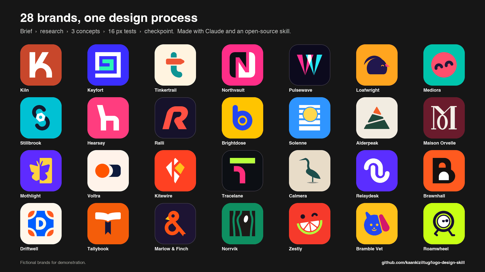
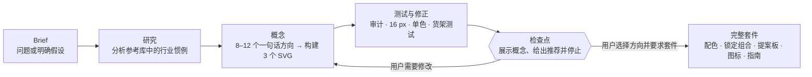
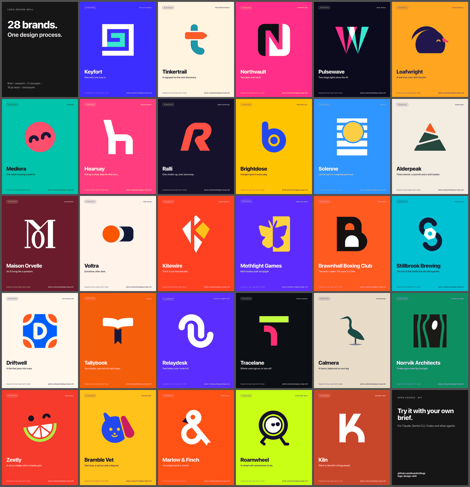
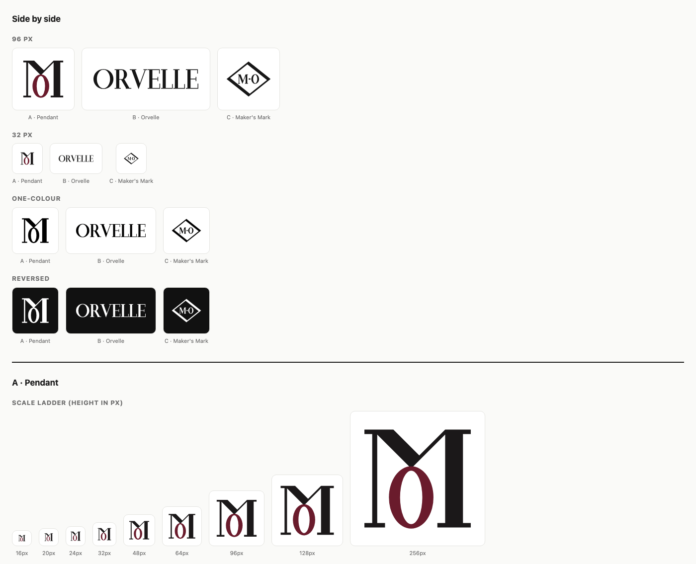

# 面向 Claude 与 AI Agent 的 Logo Design Skill

[English README](README.md) | 简体中文

[](https://github.com/kaankiziltug/logo-design-skill/actions/workflows/test.yml) [](#)



这是一套完整的 **Logo 设计技能**，可把 Claude、Gemini CLI、Codex CLI、Cursor、GitHub Copilot 等支持 Agent Skills 的 AI Agent，变成遵循设计纪律的品牌标识设计师，覆盖从第一次需求访谈到可生产 SVG 和品牌指南的完整流程。

- **原则与流程**：需求发现、设计 brief、词义映射、标记类型选择、概念发想、几何构建、光学修正（溢出、骨骼效应、光渗等）、色彩、字体、锁定组合、测试、提案、交付、品牌重塑和识别系统。
- **1,400+ 个真实 Logo SVG 参考库**：每件参考均按标记类型、技巧、几何、主题、字体、情绪和行业分类，可在命令行检索，也可在本地画廊浏览。参考库用于学习结构和识别行业惯例，绝不能复制或描摹。
- **零依赖 Python 工具**：审查 SVG 是否符合 Logo 原则，生成概念总览图、16 px 像素测试与多场景测试表，制作带行业样机的客户提案板，渲染 PNG，并导出 favicon、应用图标和 Web manifest 套件。

**目录：** [工作原理](#工作原理) · [安装](#安装) · [示例](#示例) ·
[测试](#测试能发现什么) · [使用](#使用) · [目录内容](#目录内容) · [参考库](#参考库概览)

## 工作原理



技能始终在**概念检查点停止**：只展示一张概念总览图、推荐意见和完整套件说明；用户确认方向之前不继续制作。完整套件工作量最大，也只应在方向获批后制作。

## 安装

本集成包通过 `codex-skills` manifest 和根 `SKILL.md` 分发，执行入口为 `skills/logo-design/`。以下上游安装方式用于独立使用。

### Claude Code 插件市场

```text
/plugin marketplace add kaankiziltug/logo-design-skill
/plugin install logo-design@logo-design-skill
```

### Claude Code 手动安装

```bash
git clone https://github.com/kaankiziltug/logo-design-skill.git
cp -r logo-design-skill/skills/logo-design ~/.claude/skills/logo-design
```

项目级安装：

```bash
cp -r logo-design-skill/skills/logo-design .claude/skills/logo-design
```

### Claude.ai / Claude Desktop

从[上游 Releases](https://github.com/kaankiziltug/logo-design-skill/releases)下载 `logo-design.zip`，在 **Settings → Capabilities → Skills** 中上传。若受大小限制，可使用不含 SVG 参考文件的 `logo-design-lite.zip`。打包脚本只在上游仓库维护。

### Gemini CLI、Codex CLI 与其他 Agent

技能使用开放 Agent Skills 格式，由一个包含 `SKILL.md` 的目录组成，指令为 Markdown，工具为标准 Python。

| Agent | 个人级目录 | 项目级目录 |
|---|---|---|
| Gemini CLI | `~/.gemini/skills/logo-design` 或 `~/.agents/skills/` | `.gemini/skills/logo-design` |
| Codex CLI | `~/.codex/skills/logo-design` | `.codex/skills/logo-design` |
| Cursor、GitHub Copilot、OpenCode 等 | 见各 Agent 的 Skills 文档 | 通常是项目内的 `skills/` |

```bash
cp -r logo-design-skill/skills/logo-design ~/.gemini/skills/logo-design
cp -r logo-design-skill/skills/logo-design ~/.codex/skills/logo-design
```

新开一个会话后直接提出 Logo 需求即可。模型若支持查看图片会得到更好结果，因为技能会先自行渲染 PNG 并检查，再向你展示。

## 示例



以下 28 个虚构 brief 均从头到尾运行过技能。每例包含检查点的灰度概念、真实 64/32/16 px 尺寸、推荐方向，以及选定方向在行业样机中的彩色应用。最近批次刻意探索高饱和配色，同时仍要求通过单色和 3:1 对比度测试。

| 品牌 | 领域 | 风格 | 选定标记 |
|---|---|---|---|
| **Kiln** | 精品咖啡烘焙 | 温暖、手作、现代 | 字母形 + 定制字标 |
| **Zestly** | 食品配送 App | 活泼、鲜亮、番茄红与青柠 | 吉祥物 |
| **Maison Orvelle** | 奢侈时装 | 高对比 Didone | 字母组合 |
| **Pulsewave** | 音乐与艺术节 | 霓虹、夜间、动感 | 抽象字母形 |
| **Tinkertrail** | 儿童 STEM 教育 | 俏皮、圆润、多彩 | 字母形 |
| **Ralli** | 板式网球 App | 运动斜体、电光珊瑚 | 字母形 |
| **Alderpeak** | 户外装备 | 粗犷、石板感、泥土色 | 具象符号 |
| **Driftwell** | 冲浪旅舍与咖啡馆 | 葡式瓷砖、海岸高饱和色 | 徽章 + 符号 |
| **Calmera** | 理疗诊所 | 柔软、有机、平静 | 具象符号 |
| **Bramble Vet** | 宠物医院 | 友好角色、阳光色 | 吉祥物 |
| **Voltra** | 太阳能 | 几何、电压橙 | 抽象符号 |
| **Keyfort** | 密码管理器 | 严格网格、电光靛与薄荷 | 抽象符号 |
| **Relaydesk** | 客服 SaaS | 圆润、紫罗兰与珊瑚 | 抽象符号 |
| **Tracelane** | 产品分析 | 技术感、酸性绿与粉色 | 字母形 |
| **Tallybook** | 小型企业财务 | 友好、橘红与青绿 | 字母形 |
| **Northvault** | 数字银行 | 大胆色块、洋红 | 字母形 |
| **Mediora** | 远程医疗 | 柔和珊瑚脸与青绿 | 吉祥物 |
| **Brightdose** | 在线药房 | 阳光黄与钴蓝 | 字母形 |
| **Hearsay** | 播客网络 | 大胆粉色、对话感 | 字母形（客户选择） |
| **Norrvik** | 建筑工作室 | 克制、云杉绿 | 抽象符号 |
| **Brawnhall** | 拳击馆 | 厚重、高可视橙 | 字母形（客户选择） |
| **Solenne** | 护肤 | 日光蓝与金色 | 具象标记（客户选择） |
| **Mothlight** | 独立游戏 | 紫外线与灯光黄 | 负空间 |
| **Loafwright** | 酸面包店 | 温暖万寿菊黄 | 吉祥物 |
| **Stillbrook** | 精酿啤酒 | 绿松石与锻造橙 | 字母形 |
| **Marlow & Finch** | 房地产代理 | 雀鸟橙与墨色 | 具象与符号 |
| **Kitewire** | AI Agent 平台 | 风筝红与上升气流黄 | 字母形 |
| **Roamwheel** | 电动自行车订阅 | 荧光青柠与墨色 | 吉祥物（客户选择） |

其中 Kiln 通过字母 K 的窑口拱形形成识别；Keyfort 用一条不断向内收的希腊回纹组成城堡；Brightdose 在小写 b 的封闭空间里藏入太阳；Tracelane 用一条分岔路径同时形成 T 和漏斗；Marlow & Finch 把名称中的 `&` 变成停驻的雀鸟。四个案例在检查点选择了与技能推荐不同的概念，技能随后按客户选择完成修正和配色。

## 测试能发现什么

每个概念在检查点前都会经过 `svg_audit.py` 和 `preview_sheet.py`。测试表并排展示 96/32 px、单色、反白、模糊、镜像、favicon、应用图标、头像、网站页眉、名片和竞品货架等场景。



```text
$ python3 scripts/svg_audit.py a-lockup.svg b-emblem.svg

=== a-lockup.svg
viewBox 0 0 905 256 · aspect 3.535 (horizontal) · colours 1 · anchors 205
· INFO [complexity] 205 anchor points (library median 75, p75 155)
production-readiness score: 99/100

=== b-emblem.svg
viewBox 0 0 256 256 · aspect 1.0 (square) · colours 1 · anchors 374
▲ WARN [complex] 374 anchor points
▲ WARN [near-miss-angle] 8 straight edges are 0.3–3° off a clean angle
▲ WARN [tiny-detail] 6 sub-shapes are smaller than 1/48 of the canvas
production-readiness score: 76/100
```

审计会把工艺原则转成客观检查：结构、颜色、复杂度、近失角度、微小细节、画布留白、居中、描边、光栅、实时文字和视觉对比度。

## 使用

直接提出需求即可：

> *“为 Harbor 设计一个 Logo，它是一款面向首次储蓄用户的储蓄 App，希望感觉平静、安全。”*  
> *“这是我现有的 Logo（logo.svg），请审查并提出刷新建议。”*  
> *“为精品咖啡烘焙品牌 Kiln 提供三个字标方向。”*  
> *“把这个符号做成 favicon、应用图标和单色版本，再加一页使用规范。”*

也可直接运行工具：

```bash
cd skills/logo-design
python3 scripts/search_library.py --technique negative-space --exemplary
python3 scripts/search_library.py --industry payments-fintech --summary
python3 scripts/svg_audit.py my-logo.svg
python3 scripts/concept_sheet.py a.svg b.svg c.svg --names "A" "B" "C" --recommend 1 -o concepts.png
python3 scripts/preview_sheet.py my-logo.svg --refs-industry developer-tools -o preview.html
python3 scripts/render_png.py my-logo.svg --size 512 -o my-logo.png
python3 scripts/export_variants.py my-logo.svg --mono "#0F7C80" --icon-bg "#0F7C80" --web-icons
open assets/library/gallery.html
```

需要 Python 3.8+，所有工具只使用标准库。PNG/ICO 导出会选择现有渲染器：`cairosvg`、`rsvg-convert`、Inkscape、Chromium 浏览器或 macOS Quick Look。

## 目录内容

```text
skills/logo-design/
├── SKILL.md
├── references/
│   ├── principles.md
│   ├── discovery-brief.md
│   ├── mark-types.md
│   ├── visual-techniques.md
│   ├── color.md
│   ├── typography.md
│   ├── process.md
│   ├── svg-construction.md
│   ├── testing-checklist.md
│   ├── presentation-delivery.md
│   ├── identity-system.md
│   ├── redesign.md
│   ├── critique.md
│   └── library-guide.md
├── scripts/
│   ├── concept_sheet.py
│   ├── search_library.py
│   ├── svg_audit.py
│   ├── preview_sheet.py
│   ├── presentation_board.py
│   ├── render_png.py
│   ├── export_variants.py
│   └── build_catalog.py
├── templates/
└── assets/library/
    ├── svg/                 # 1,400+ 个参考 Logo
    ├── catalog.json
    ├── classifications.json
    ├── stats.json
    └── gallery.html
```

## 参考库概览

1,400+ 个文件，约 1,200 个品牌，其中 233 个品牌同时包含锁定组合和独立图标。标记类型占比：抽象 24%、组合 21%、具象 20%、字母形 15%、字标 10%、徽章 4%、吉祥物 4%、字母标 3%。中位配色数为 2，75% 使用不超过 3 种颜色；19% 含渐变；141 个文件标记为优秀教学案例。详见 [`references/library-guide.md`](skills/logo-design/references/library-guide.md)。

## 许可与商标

技能文本、脚本、模板和目录数据采用 [MIT](LICENSE)。`assets/library/svg/` 中的 Logo 是其各自所有者的商标，只用于参考和教育，不包含在 MIT 授权范围内，详见 [TRADEMARKS.md](TRADEMARKS.md)。README 示例中的品牌均为用于演示技能而创建的虚构 brief。
